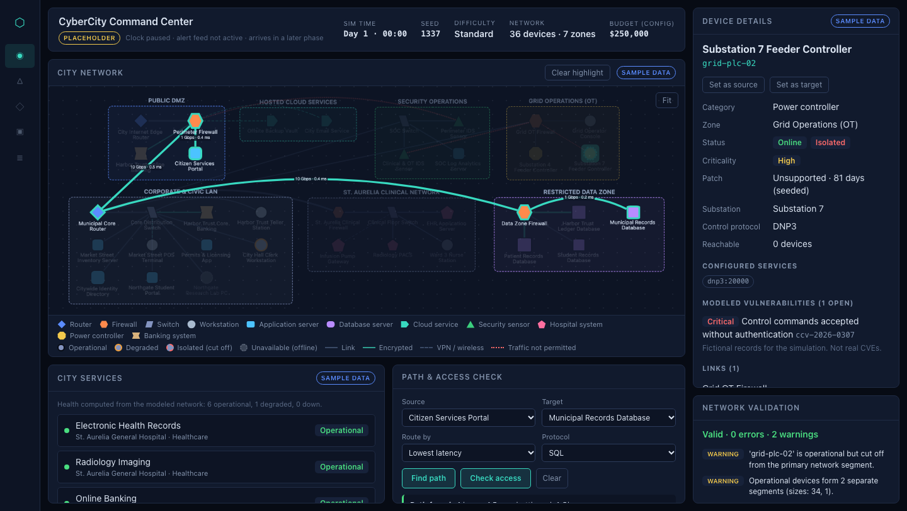

# CyberCity

An interactive cybersecurity strategy simulator. You defend a fictional city
whose hospitals, banks, power grid, government services, university and
businesses share one interconnected network.

> **Simulation only.** CyberCity never scans, connects to, or attacks real
> systems. Every device, organization, vulnerability and event is invented and
> lives in memory.

**Status: Phase 2 (network modeling engine).** The backend models a 36-device
city with zones, segmentation policies and service dependencies. The
frontend shows it as an interactive zone map with device details, path
finding, access checks and service health. Threat simulation, defenses,
budgets and campaigns come in later phases.



## What's implemented

- **Typed device models** for 11 categories, each with status, zone,
  criticality, configured services, patch status and fictional vulnerabilities.
- **Topology engine** (`NetworkManager`, NetworkX): add and remove
  devices and links, neighbors, reachability, shortest paths (by hops or
  latency), segments, isolated devices, and reference validation.
- **Zone access policy**: priority-ordered allow/deny rules, deny wins ties,
  default deny, and a plain-English reason for every decision.
- **Connection checks**: device status + configured service + policy + path,
  each reported separately.
- **City services**: services depend on several devices across zones, and
  health is computed from those checks.
- **Pre-simulation validation** that blocks invalid cities and warns about
  isolated or offline devices.
- **Map**: zones as boxes, shape and color per category, operational /
  degraded / isolated / unavailable states, link properties, path
  highlighting, and a legend.

See [docs/architecture.md](docs/architecture.md) for design decisions and
the model's **simplifications**.

## Tech stack

| Layer | Tools |
| --- | --- |
| Backend | Python 3.12+, FastAPI, Pydantic v2, NetworkX, pytest |
| Frontend | React 19, TypeScript, Vite, Cytoscape.js, Vitest, Testing Library |
| Storage | In-memory (SQLite planned) |

## Project layout

```
CyberCity/
├── backend/
│   ├── app/
│   │   ├── main.py              # app factory
│   │   ├── api/                 # routers: simulation, network, policy, city; errors; params
│   │   ├── models/              # devices, network, policy, city, analysis, simulation
│   │   ├── simulation/          # network_manager, policy, connectivity, service_health,
│   │   │   │                    #   validation, state
│   │   │   └── sample_city/     # devices, topology, policy, services
│   │   └── services/            # SimulationService + domain errors
│   ├── tests/                   # pytest suite + factories.py (tiny test graphs)
│   ├── requirements.txt
│   └── pyproject.toml           # pytest configuration only
├── frontend/
│   ├── src/
│   │   ├── components/          # Panel, DataBadge, StatusTag, layout (Sidebar, TopBar)
│   │   ├── features/            # network-map, details, path-tools, city-services, validation
│   │   ├── pages/               # CommandCenterPage
│   │   ├── services/            # typed API client
│   │   ├── hooks/               # useSimulationData, useAsync
│   │   ├── types/               # TS mirrors of backend models
│   │   └── styles/, test/
│   └── vite.config.ts           # dev proxy /api → :8000, Vitest config
└── docs/architecture.md
```

## Setup (macOS)

Prerequisites:

- **Python 3.12+** (`python3 --version`). Tested on 3.13.
- **Node.js 22 or 24 LTS** (`node --version`). `frontend/.nvmrc` pins 24.
  Node 25 works, but npm prints engine warnings for Vitest and jsdom.

```bash
# Backend
cd backend
python3 -m venv .venv
source .venv/bin/activate
pip install -r requirements.txt

# Frontend (new terminal)
cd frontend
npm install
```

## Running

**Terminal 1: API on http://127.0.0.1:8000 (interactive docs at /docs)**

```bash
cd backend
source .venv/bin/activate
uvicorn app.main:app --reload --port 8000
```

**Terminal 2: UI on http://localhost:5173**

```bash
cd frontend
npm run dev
```

Open **http://localhost:5173**. Use `localhost`, not `127.0.0.1`, because
Vite listens on the IPv6 loopback by default.

## API

All routes are under `/api`. Errors always use
`{"error": {"code", "message", "details"}}`.

| Method | Path | Description | Errors |
| --- | --- | --- | --- |
| GET | `/health` | Liveness check | |
| GET | `/simulation` | Config, tick, and counts | |
| POST | `/simulation` | Start a new simulation from a `SimulationConfig` body | 422 invalid config |
| GET | `/network` | Complete topology: zones, devices, links, segments, isolated devices | |
| GET | `/network/zones` | Zones with their device IDs | |
| GET | `/network/devices/{device_id}` | Device, zone, links, reachable devices, dependent services | 404 unknown, 422 malformed ID |
| GET | `/network/path?source=&target=&metric=hops\|latency` | Shortest usable path. `found: false` (200) when none exists | 404, 422 |
| GET | `/network/validation` | Validation report for the current city | |
| GET | `/policy/rules` | Access rules in evaluation order | |
| GET | `/policy/check?source=&target=&protocol=` | Would simulated traffic be permitted? Step-by-step explanation | 404, 422 |
| GET | `/city/organizations` | Organizations and sectors | |
| GET | `/city/services` | Services with dependencies and current health | |
| GET | `/city/services/{service_id}` | One service with health | 404, 422 |

Examples:

```bash
curl 'http://127.0.0.1:8000/api/network/path?source=biz-pos-01&target=bank-ledger-db-01&metric=latency'
curl 'http://127.0.0.1:8000/api/policy/check?source=web-portal-01&target=gov-db-01&protocol=sql'
curl -X POST http://127.0.0.1:8000/api/simulation \
  -H 'Content-Type: application/json' -d '{"seed": 2024, "difficulty": "challenging"}'
```

`SimulationConfig`: `seed` (0–4294967295), `city_name`, `difficulty`
(`training` | `standard` | `challenging`), `starting_budget`, `tick_minutes`.
Unknown fields are rejected.

## Testing

```bash
# Backend (from backend/, venv active)
python -m pytest            # 171 tests

# Frontend (from frontend/)
npm test                    # Vitest: 40 tests
npm run typecheck
npm run build               # typecheck + production build
```

Backend tests use tiny graphs built in `tests/factories.py`. They cover device
and connection add/remove, invalid IDs, pathfinding (tie-breaks, latency,
blocked links), reachability, segments, default deny, rule priority and
ties, connection checks, service health, validation, sample-city
invariants, determinism, and every API endpoint's schema and errors.

Frontend tests cover the zone layout, Cytoscape element mapping, the
detail views, the path and access tool, the API client, and the page (with
the canvas map mocked).

## Current limitations

- **No threats or gameplay yet.** The clock doesn't advance, no security
  events are generated, and the alert feed is a labeled placeholder.
- **Simplified network model.** Policy is checked end to end between zones,
  not per firewall hop. There is no capacity or congestion, and health is a
  three-level rule. See *Simplifications* in the architecture doc.
- **Read-only API.** `NetworkManager` supports adding and removing devices
  and links, but no HTTP endpoints expose mutation yet.
- **In-memory state.** Restarting the API resets the simulation, and there is
  one shared simulation per server process.
- **Fixed sample city.** `POST /api/simulation` reseeds the bundled city and
  can't load custom cities over HTTP yet (the app factory accepts one in code).
- **Hand-synced types.** `frontend/src/types` mirrors the Pydantic models manually.
- **Map scale.** At about 1280×800 the full map renders small. Scroll to zoom
  and press **Fit** to reset. Long links can still cross zone boxes.
- **Bundle size.** Cytoscape makes the JS bundle about 680 KB (about 215 KB gzipped).
